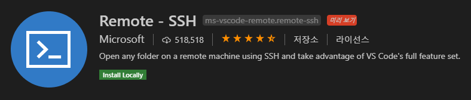
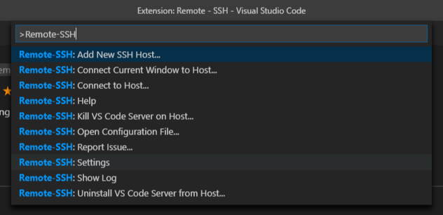
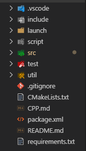

필자는 **Windows 10 데스크탑**과 **macOS 노트북**을 사용하고 있다. 주로 카페에서 작업하는 방식을 이용하고 있고, 다행히 Node.js와 Android 작업을 하기 때문에 별다른 애로사항은 없었다.

하지만 최근 문제가 발생했다. 진행하고 있는 드론 프로젝트 때문에 **ROS** 환경에서의 작업이 필요하다는 것이다. [**ROS**](https://www.ros.org/)는 Robot Operating System의 약자로, 로봇 응용 프로그램 개발 프레임워크라고 할 수 있다. 자세한 설명은 [공식 문서](http://wiki.ros.org/ROS/Introduction)를 참고하면 좋다. 참 좋은 이 프레임워크의 문제는 바로 **Linux** 환경에서만 실행할 수 있다는 것이다. (차세대 버전 [**ROS2**](https://index.ros.org/doc/ros2/)는 **Windows** 환경도 지원한다. 이 내용은 다음에 다루기로 하자.) 또 하나의 제약(?)은 내가 맥북으로 작업하는 것을 선호한다는 것이다. 그렇다고 **Virtual Box**를 이용해서 가상 환경을 구축하자니 매끄럽지 않은 환경이 마음에 들지 않았다. 그러다 **VSCode**를 이용하여 원격 코딩을 할 수 있다는 [글](https://code.visualstudio.com/docs/remote/remote-overview)을 보게 되었다.

준비 사항: Visual Studio Code, Linux 서버

\[1\] 우선 **Visual Studio Code**에서 **Remote - SSH** 플러그인을 설치한다.

*Visual Studio Code의 Remote - SSH 플러그인 (by. Microsoft)*

\[2\] **Ctrl+Shift+P**를 누른 후, **Remote-SSH: Connect to Host...**를 선택한다.

*Ctrl+Shift+P -> Remote-SSH: Connect to Host...*

\[3\] 접속할 호스트 이름과 비밀번호를 입력한다. (e.g. root@127.0.0.1)

\[4\] 원격 서버에 접속하여 작업을 이어나간다.

*원격 서버의 프로젝트 폴더 구성*

**Gazebo** 등의 GUI 환경 조건이 추가된다면 어쩔 수 없이 **Virtual Box**로 가상 머신을 구축하게 되겠지만, **ROS-Base** 수준에서는 위와 같은 방법으로 개발 환경을 갖출 수 있다.

\-끝-
