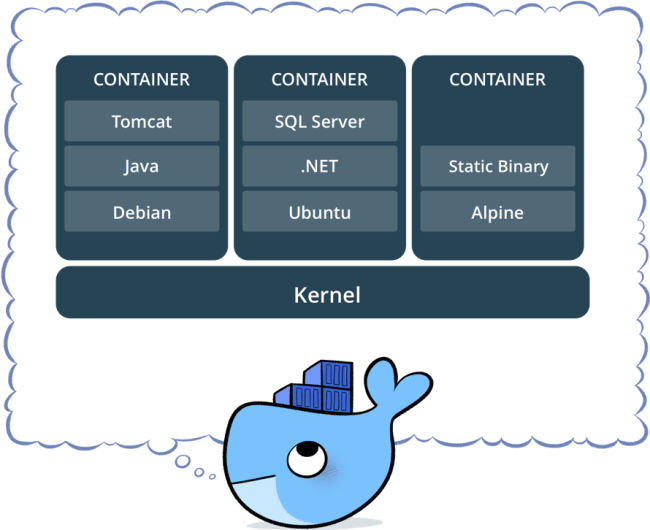
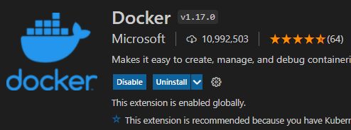
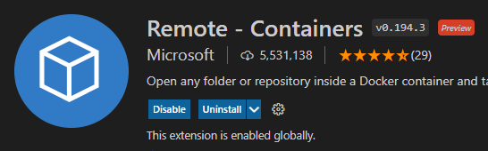
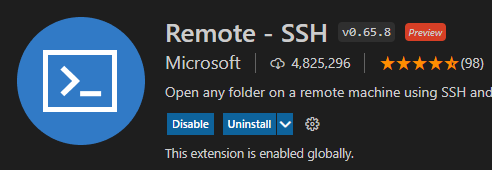
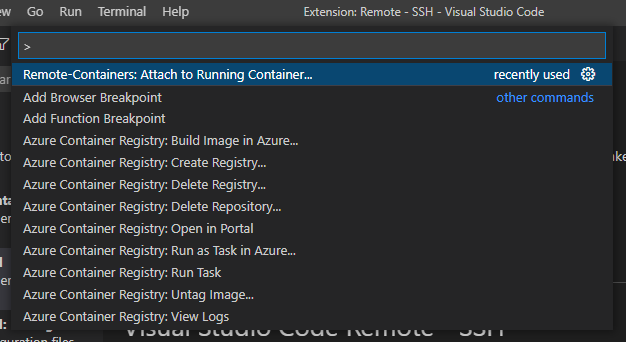

필자는 2019년 다음과 같은 글을 작성하였다. ([https://rapsealk.tistory.com/10](https://rapsealk.tistory.com/10))

하지만 시간은 흐르고, 이제는 Linux 환경을 넘어 Docker를 다룰 줄 아는 것이 기본 소양인 시대가 되었다.



*Docker*

준비사항: Visual Studio Code, Docker가 실행 중인 (원격) 서버

참고: [https://code.visualstudio.com/docs/containers/ssh](https://code.visualstudio.com/docs/containers/ssh)

\[0\] 현재 PC에 접속할 서버에 대한 fingerprint가 저장된 상태인지 확인한다. 처음 접속하는 경우라면, 아래의 명령어를 통해 서버에 접속하기 위한 fingerprint를 생성 및 저장할 수 있다.

```shell
> ssh <USER>@<HOSTNAME>[:<PORT>]
```

\[1\] Visual Studio Code에서 필요로 하는 Extension을 설치해 준다.



*VSCode: Docker*



*VSCode: Remote - Container*



*VSCode: Remote - SSH*

\[2\] File > Preferences > Settings에 들어간 후 docker.host 항목에 접속할 ssh 서버 주소를 입력한다.

\[3\] Ctrl+Shift+P를 누른 후, Remote-Containers: Attach to Running Container...를 선택한다.



*Attach to Running Container...*
