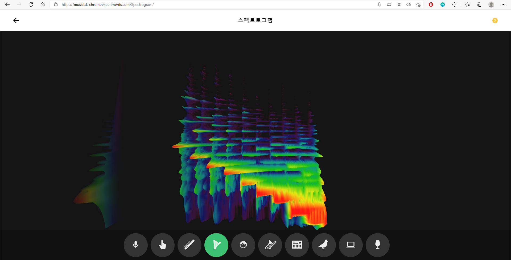
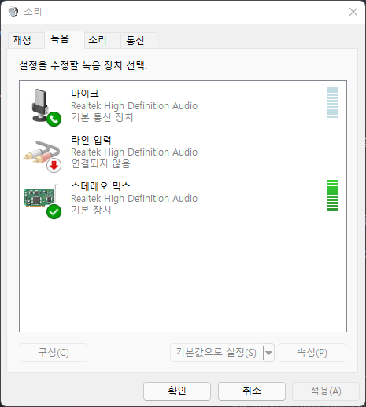

\* 이 글에서 나오는 프로그램은 웹사이트를 돌아다니며 미술관에서 작품을 안내하는 **도슨트**처럼 각 사이트의 내용을 설명해주는 기능을 한다. 사용자는 프로그램에 내장된 WebView를 통해 일정 시간마다 각 사이트로 이동하게 되고, 매 사이트에 도착할 때마다 그곳을 설명하는 나레이션이 실행된다.

프로그램을 개발하는 과정에서 재밌는 요구사항이 있었다. 이 프로그램에서 방문하는 사이트 중에는 아래와 같은 사이트도 있었다.

[https://musiclab.chromeexperiments.com/Spectrogram/](https://musiclab.chromeexperiments.com/Spectrogram/)

이 사이트는 다양한 소리의 스펙트로그램을 시각화하여 보여주는 기능을 제공한다. 플룻, 하프, 휘파람 등의 샘플 소리들을 기본적으로 제공해주며, 마이크를 통해 입력된 소리를 이용할 수도 있다. 또한 드래그 앤 드롭을 통해 midi 이외의 오디오 파일의 실행도 지원해준다.



*Chrome Music Lab의 Spectrogram 서비스*

이 재미난 사이트에서 주어진 요구사항은 아래와 같다.

> 현재 실행되고 있는 나레이션의 스펙트로그램을 보여주도록 한다.

이 요구사항을 충족하기 위해 밟아온 단계들을 차례로 정리하고자 한다.

0\. 가상 Element 파헤치기

사용자의 마이크 입력을 전달받기 위해서는 아래에 있는 여러 버튼들 중 가장 왼쪽에 있는 버튼을 클릭해야 한다. 이 과정을 자바스크립트로 구현하는 과정에서 버튼의 클래스 이름을 알아내고 아래와 같은 방식으로 접근했다.

```javascript
document.getElementsByClassName('music-box__buttons__button');
```

하지만 결과는 텅 빈 HTMLCollection\[\]가 돌아올 뿐이었다. 몇 번의 시행착오를 통해 해당 요소가 iframe을 통해 불러온 것이며, 가상 Element로 이루어졌음을 확인할 수 있었다. 가상 Element는 사용자의 입력이 발생하기 전에는 Element에 접근이 되지 않는 것 같다. 아래와 같은 iframe 태그를 찾을 수 있었고, 실제 기능을 수행하는 페이지의 주소를 알아낼 수 있었다.

```html
<iframe id="experimentFrame"></iframe>​
```

[https://musiclab.chromeexperiments.com/spectrogram-service/?ln=ko](https://musiclab.chromeexperiments.com/spectrogram-service/?ln=ko)

1\. StereoMix

첫 번째로 사용한 방법은 StereoMix를 이용한 방법이다. 정확히는 Chrome Music Lab의 마이크 기능을 이용하기 위하여 StereoMix를 통해 소리를 전달하도록 하였다.

StereoMix는 현재 스피커에 출력되고 있는 소리를 녹음할 수 있도록 해주는 가상 오디오 입력 장치다. 오디오 입력 장치를 StereoMix로 설정한 후 마이크 버튼을 누르면 실행 중인 소리를 그대로 입력으로 전달할 수 있다.



*Stereo Mix 오디오 장치 (Windows)*

StereoMix의 설정 방법은 아래와 같다.

1.  [Realtek High Definition Audio (SST) 드라이버](https://www.intel.com/content/www/us/en/download/19336/realtek-high-definition-audio-driver-for-windows-10-64-bit-for-nuc8i7be-nuc8i5be-nuc8i3be.html)를 설치한다.
2.  제어판 > 하드웨어 및 소리 > 소리로 이동한 후, 녹음 장치를 스테레오 믹스로 설정한다.

이렇게 설정한 후 정상적으로 기능이 작동함을 확인할 수 있었다. 하지만 이런 방법에는 아래와 같은 문제점이 있었다.

1.  실행 PC에 Realtek 드라이버가 설치되었음을 보장할 수 없다.
2.  오디오 입력 장치를 임의로 설정/변경하는 방법을 찾지 못했다. (레지스트리로 접근했지만..)

따라서 별도의 설정이 필요하지 않은 드래그 앤 드롭 기능을 이용하는 방법으로 변경하기로 했다.

2\. Drop Event

드래그 앤 드롭 기능을 이용하기 위해서는 'drop' 이벤트를 어떻게 처리하는지 확인할 필요가 있었다. 따라서 해당 페이지에서 동작하는 자바스크립트 코드를 분석하기로 했다. 그렇게 지옥문이 열렸다.

[https://musiclab.chromeexperiments.com/js/app.js](https://musiclab.chromeexperiments.com/js/app.js)

2-1. 어떤 Element가 이벤트를 처리하는가?

아름다운 minify가 적용되어 덤으로 난독화까지 적용된 모습이었다. 우선 'drop' 이벤트에 대한 처리 방식을 찾아야 했기 때문에, 'drop' 단어를 검색해봤다. 그 결과 아래와 같은 처리 함수가 등록되었음을 확인할 수 있었다.

```javascript
function (n) {
	n.preventDefault(), n.stopPropagation(), e.addClass("pointer-events"), i();
	var s = n.originalEvent.dataTransfer;
	s && s.files.length && s.items[0] && "audio/midi" !== s.items[0].type
		? $.each(s.files, function (n, i) {
			i.type.indexOf("audio") > -1
				? ($("#loadingMessage").text(i.name), $("#loadingSound").show(0), r(i), e.removeClass("active"), e.removeClass("pointer-events"))
					: t.text("Only sound files will work here.");
		})
		: t.text("Only sound files will work here.");
}
```

이제 저 처리 함수가 어떤 Element에 등록되었는지 확인해야 했다. 이것을 확인하기 위하여 사용자가 파일을 드롭하는 영역에 'drop' 이벤트 리스너를 추가하였고, 파일을 드랍했을 때 실제로 반응하는 Element가 무엇인지 확인했다.

2-2. 어떻게 파일을 전달할 것인가?

위의 이벤트 처리 함수를 보면 dataTransfer에 담긴 파일을 처리하는 방식임을 알 수 있었다. 그렇다면 이제 audio/mp3 파일을 dataTransfer에 담아서 전달해주기만 하면 될 것 같다. dataTransfer에 대한 내용은 아래에서 확인할 수 있었다.

[https://developer.mozilla.org/en-US/docs/Web/API/HTML\_Drag\_and\_Drop\_API/Drag\_operations](https://developer.mozilla.org/en-US/docs/Web/API/HTML_Drag_and_Drop_API/Drag_operations)

[https://developer.mozilla.org/ko/docs/Web/API/DataTransfer](https://developer.mozilla.org/ko/docs/Web/API/DataTransfer)

2-3. 아뿔싸! originalEvent가 무엇인가?

jQuery에서는 DOM Event 객체를 jQuery.Event 객체로 래핑하여 사용함을 알 수 있었다.

[https://api.jquery.com/category/events/event-object/](https://api.jquery.com/category/events/event-object/)
