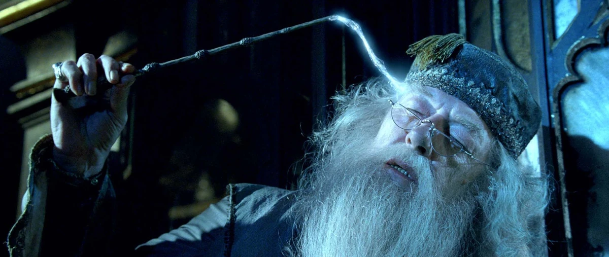
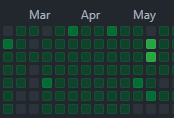
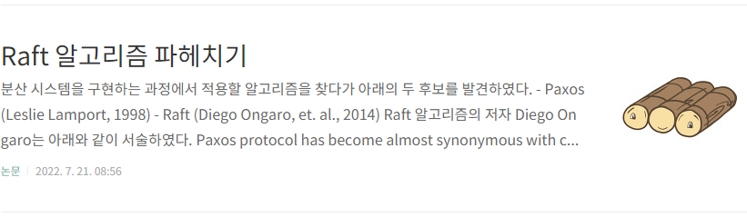

2022년 마지막 근무를 했던 12월 30일에 팀원분들과 연말을 기념하는 커피챗 미팅을 잡게 되었다. 팀 리드님께서 한 해를 되돌아보며 기억하자는 의미에서 "기년회"를 제안해 주셨고, 덕분에 나도 어떤 시간을 보냈었는지 돌이켜 볼 수 있는 기회가 되었다. 기년회에 대한 내용은 이 [블로그](http://egloos.zum.com/agile/v/4016733 "망년회 대신 기년회")를 참고하시길 바란다.

올해는 어떤 항목들로 기억을 분류해 보면 좋을까 고민을 하다가 시간순으로 나열해 보기로 했다.

*기억 뽑아내는 중 (출처: 해리포터와 혼혈왕자)*

**1월**

2021년 10월부터 12월까지 진행하던 프로젝트의 1차 시연을 성공적으로 마치고, 최종 배포를 위한 안정화 작업을 진행했다. 이 프로젝트는 데스크톱 환경에서 실행되는 Electron 기반 클라이언트로 아래와 같은 특징들로 인하여 그동안 개발했던 프로그램들과 결을 달리 하는데, 이에 적합한 개발 방법을 끝내 찾지 못하고 마무리하게 된 것 같아 아쉬움이 많이 남는다.

\- 사용자 PC의 시간을 강제로 변경한다. 이 기능은 관리자 권한을 필요로 하는데, 프로그램을 실행할 때 "관리자 권한으로 실행"을 선택할 수 있는 Windows와는 달리 macOS에서는 터미널에서 sudo 명령어로 시작해야 했다. 대상 사용자가 터미널을 하지 않는 (개발직군 외의) 일반적인 PC 사용자인 점을 생각했을 때 썩 유쾌한 방법은 아니었던 것 같다.

\- 백그라운드에서 실행되고 있는 음성 파일이 진행됨에 따라 이벤트를 발생시켜야 한다. 문제는 이 이벤트가 웹페이지를 이동하거나 스크립트를 실행시키는 것이었는데, 매우 당연하게도 사용자의 네트워크 환경에 따라 로딩 속도에 차이가 있었다. 따라서 웹페이지의 로딩이 끝나는 시점을 알아야 했는데, 당시의 접근 방법이었던 [DomContentLoaded](https://developer.mozilla.org/ko/docs/Web/API/Window/DOMContentLoaded_event) 이벤트로는 이미지 등의 리소스들의 로딩 시점은 알 수 없었다.

그 외에도 마우스 커서를 일시적으로 변경하거나 Electron WebView에서 내부 DOM에 접근하는 스크립트를 실행하는 등 매우 도전적인 이슈들이 많았다. 당시에 작성했던 [글](https://rapsealk.tistory.com/20)이 하나 있는데, 지금 돌이켜보면 나름 재밌는 이슈였던 것 같다.

**2월**

첫 커리어를 시작했던 직장에서 퇴사했다. 당시 사내의 소프트웨어 개발 업무를 전담하여 진행하는 과정에서 많은 고민들이 생겼었다.

\- 개발 능력에 대한 자신감과 생산력이 떨어졌다.

\- 업무적으로나 일상적으로나 사람을 만날 일이 없으니 갈수록 외로움이 커졌다.

그러던 중 커뮤니티를 통해 한 시니어와 깊은 대화(라기보다는 검증의 시간)를 할 기회가 생겼는데, 여기에서 큰 충격을 받게 되었다. 그 결과 조금 갑작스럽지만 퇴사를 결정하게 되었고, 7개월 간의 여정을 마치고 집으로 돌아오게 되었다.

**3월**

Back to the basic이라는 마음가짐으로 나를 검증하는 시간을 가지기로 했다. 지금까지 알고 있다고 생각했던 내용들을 다시 확인하는 과정을 거쳤으며, 조금 더 나은 개발 방법을 찾기 위하여 새로운 사이드 프로젝트를 진행하였다. 어차피 백수였기 때문에 시간은 많았으므로 매일매일 조금씩이라도 꾸준히 진행하려고 했다. 소위 말하는 "잔디심기"를 신경 쓰는 편은 아니지만, 이 기간 동안만큼은 내가 어떻게 진행했는지를 나타내는 하나의 지표가 되어 줄 수는 있을 것 같다.

*3월 14일부터 5월 6일까지*

**4월**

한 달간의 수련을 끝마치고 다시 이력서를 작성하고 구직 활동을 시작했다.

**5월**

5월 9일 래블업 주식회사에 입사했다.

**6월**

6월 14일부터 전문연구요원으로서 병역을 시작하게 되었다.

**7월**

Raft 합의 알고리즘 공부를 시작했다. 이 게시물의 끝을 지어보려 한다.

*Raft 합의 알고리즘*

**8월**

**9월**

새로운 프로젝트인 Backend.AI FastTrack 개발에 참여하게 되었다.

[Backend.AI MLOps 플랫폼 FastTrack을 소개합니다. | Lablup Blog](https://blog.lablup.com/posts/2022/11/29/introduce-fasttrack)

**10월**

논산훈련소에 다녀오게 되었다. 3주라는 시간이 참 길게 느껴지는 곳이었다. 대한민국의 모든 장병들에게 무한한 존경을 표하고 싶다.

**11월**

**12월**
